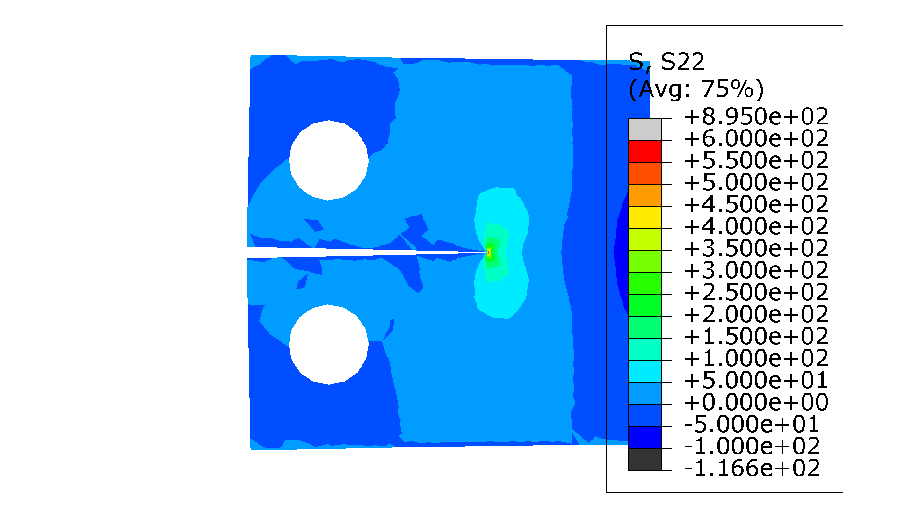
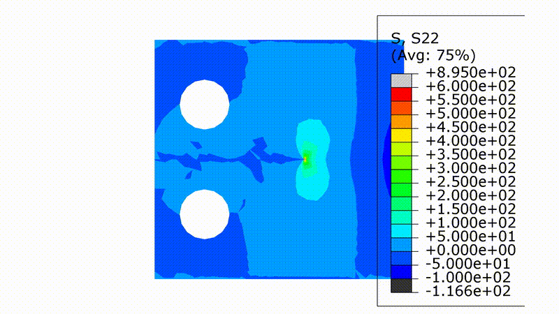

# ct-fracture-abaqus




Facteur d'intensité de contrainte K d'une éprouvette CT en acier 300M (Abaqus, intégrale J), comparé à la formule
ASTM E399, puis durée de vie en propagation de fissure (lois de Paris et de Walker), avec un bonus sur l'effet d'une
contrainte résiduelle par superposition. Tout est scripté en Python (construction du modèle, calculs, lecture,
figures) et testé.

**État :** calculs terminés, y compris la comparaison avec un second solveur (Code_Aster). Un paramètre reste sans source, et le README le dit : l'exposant γ de Walker. La ténacité
K_Ic vient de la NASA TP-1288 (valeur conservative, plage documentée).

## Résultats clés

| Résultat | Valeur |
|---|---|
| K éléments finis, a/W = 0,5 | **17,22 MPa√m**, soit **−0,33 %** par rapport à l'ASTM (17,28) |
| Convergence de maillage | K varie de **0,06 %** pour un premier élément de 0,27 à 0,05 mm (critère fixé à 0,2 %, atteint) |
| K(a), 9 longueurs de fissure | écart à l'ASTM **sous 1 %** pour a/W de 0,4 à 0,7 ; +4,0 % à 0,3 et +2,1 % à 0,35 (cause non établie, trois causes écartées) |
| Comparaison Code_Aster (G-thêta, autre maillage) | écart à Abaqus de **−0,10 % à −0,35 %** sur les 9 longueurs de fissure (critère : sous 1 % pour a/W de 0,4 à 0,7), y compris à 0,3 et 0,35 |
| Convergence de maillage Code_Aster | K varie de **0,07 %** entre les deux maillages les plus fins (2 225 et 2 889 nœuds ; critère 0,2 %) ; le plus fin donne 17,21, soit −0,02 % d'Abaqus |
| Qualité des calculs | J indépendant du contour à 0,3 % près, K2/K1 ≤ 0,04 % |
| Marge à la rupture | K_max/K_Ic = **0,62** à 35 mm (K_Ic = 62,6 MPa√m) ; 0,44 avec la borne haute de la plage (86,8) |
| Durée de vie, 300M, R = 0,1, a de 20 à 35 mm | **2,5 × 10⁵ cycles** ; K éléments finis et K ASTM donnent le même N à 0,3 % près |
| Sensibilité au paramètre m de la loi de Paris | N varie d'un **facteur 15** entre m = 2,17 et m = 3,17 ; C ±20 % donne N de +25 % à −17 % |

Courbe K(a) : `results/figures/K_vs_a.png`. Comparaison Abaqus / Code_Aster / ASTM :
`results/figures/K_vs_a_comparaison.png` et `results/K_comparaison_aster.md`. Convergence : `results/figures/convergence_maillage.png`. Propagation :
`results/figures/a_de_N.png`.

### Effet d'une contrainte résiduelle (bonus, profil et amplitude hypothétiques)

K_res est calculé par superposition (pression sur les lèvres de la fissure, pièce libre). Pour un profil auto-équilibré
de 100 MPa d'amplitude, K_res vaut **+6,9 MPa√m à 20 mm** (+53 % de K appliqué), décroît et s'annule vers 34 mm.

Variation du nombre de cycles par rapport à σ0 = 0, selon l'exposant de Walker γ (**aucune source ne le fixe** : il
est donc étudié de 0,5 à 1) :

| γ | σ0 = −100 MPa | σ0 = −50 | σ0 = +50 | σ0 = +100 |
|---|---|---|---|---|
| 0,50 | +181 % | +41 % | −17 % | −28 % |
| 0,75 | +162 % | +32 % | −9 % | −16 % |
| 1,00 | +145 % | +24 % | 0 % | 0 % |

Pour γ = 1 (loi de Paris pure), une contrainte résiduelle en traction n'a aucun effet tant que la fissure reste
ouverte : l'effet vient de γ. Une compression ralentit quand même la fissure par fermeture (K_min ramené à 0).

## Modèle et méthode

- **Éprouvette** : CT, W = 50 mm, B = 25 mm, a/W de 0,3 à 0,7, charge 10 kN (400 N par mm d'épaisseur dans le modèle 2D).
- **Matériau** : acier 300M (Ftu = 280 ksi, Fty = 230 ksi, MIL-HDBK-5J, table 2.3.1.0(f1)). Le modèle utilise
  E = 210 GPa et ν = 0,30 (acier générique) ; le handbook donne E ≈ 200 GPa et ν = 0,32.
- **Éléments finis** : Abaqus Learning Edition 2026, déformations planes, élasticité linéaire, CPE8R et CPE6, disque de
  10 couches autour de la pointe avec biais radial, environ 820 nœuds (807 à 831 ; limite de la Learning Edition : 1 000).
- **Code_Aster** (17.4.0) : même géométrie, même matériau, mêmes conditions aux limites. Maillage Gmsh 4.15 en triangles
  quadratiques (environ 1 600 nœuds), disque de pointe de 10 couches avec le même biais radial, fissure à lèvres
  séparées. K par la méthode G-thêta (`CALC_G`, option `K`), 7 couronnes dont la première est écartée (comme le
  contour 1 d'Abaqus) ; K = moyenne des couronnes 2 à 7. Détails : `docs/comparaison_code_aster.md`.
- **K officiel** : moyenne, sur les contours 3 à 10, de √(J·E'). Règle fixée avant l'étude, appliquée à tous les calculs.
- **Propagation** : Paris `da/dN = C·ΔK^m` avec C = 3,121 × 10⁻¹¹ (m/cycle, MPa√m) et m = 2,672, ajustés sur la figure
  2.3.1.4.9 du MIL-HDBK-5J (15 points numérisés, dispersion d'un facteur 1,07). Walker avec exposant γ pour l'effet de R.
- **Ténacité** : K_Ic = 62,6 MPa√m, NASA TP-1288 (Youngblood & Raghavan, 1978), table I, barre de 0,5 in en 300M,
  austénitisation 1144 K et revenu 589 K (σy = 1624 MPa). Ligne la plus proche de Fty = 230 ksi et Ftu = 280 ksi avec la
  plus faible ténacité. Plage des lignes comparables : 62,6 à 86,8 MPa√m. Critère E399 : 2,5 (K_Ic/σy)² = 3,7 mm,
  très inférieur à B = 25 mm et au ligament.
- **Contraintes résiduelles** : profil σ0(1 − 6u + 6u²) sur la largeur (force et moment nuls), pression sur les lèvres,
  pièce libre sans goupilles.

Détails, règles et décisions : `docs/hypotheses.md`.

## Validation

69 tests automatiques (pytest). Ce que la vérification a révélé en cours de projet :

- **Épaisseur** : K dépend de P/B. Appliquer 10 000 N sur un modèle d'épaisseur 1 mm donnerait un K 25 fois trop grand ;
  la charge du modèle est donc 400 N/mm.
- **Type d'élément** : un maillage mêlant des triangles CPE6M et des quadrilatères CPE8R est refusé par Abaqus ; les
  triangles sont des CPE6. Un test vérifie les types.
- **Format du .dat** : au-dessus de K = 1 000 MPa√mm, Abaqus écrit K1 sans décimales (`1210.`) ; le lecteur a d'abord
  ignoré ces valeurs. Test dédié ajouté.
- **Signe de K_res** : le premier essai avait le mauvais signe (une pression positive ouvre la fissure dans Abaqus). Un
  test de signe, d'antisymétrie et de linéarité l'a détecté avant tout calcul de K_res(a).
- **Paramètres de matériau** : C et m viennent d'une figure du handbook numérisée, avec contrôle de la dispersion, d'un
  point aberrant et de la plage de ΔK couverte. Des valeurs non vérifiables (γ confondu avec un facteur géométrique, vitesses
  2 à 5 fois plus faibles que la figure) ont été écartées. K_Ic a été relu ligne par ligne dans la table source : une
  première association valeur/traitement thermique, faite par extraction automatique, était fausse.
- **Unités de K_Ic** : le script de contrôle `verif_kic.py` a d'abord affiché K_max = 0 (facteur d'unité faux) ; il
  refuse maintenant tout K_max hors de 30 à 50 MPa√m.
- **Code_Aster, conditions aux limites des trous** : une première version liait les nœuds du bord de chaque trou par
  une simple égalité de déplacement (`LIAISON_UNIF`), ce qui bloque la rotation du pion. Le calcul tournait et K était
  stable d'une couronne à l'autre, mais valait 279 au lieu de 544 MPa√mm (−49 %). Deux indicateurs l'ont trahi : la
  réaction vaut bien 400 N/mm, mais l'ouverture à la face avant n'était que de 0,026 mm contre 0,085 mm après correction. Le
  couplage cinématique d'Abaqus laisse la rotation libre (`ur3`) : le bord du trou est un corps rigide qui peut tourner
  (`LIAISON_SOLIDE` dans Code_Aster).
- **Code_Aster, dimension du maillage** : Gmsh écrit toujours un `.med` en 3D ; Code_Aster refuse alors `DEFI_FOND_FISS`
  avec un groupe de nœuds. Le script réécrit le `.med` en vrai 2D.
- **Script contre calcul manuel** : le script reproduit le modèle construit à la main (K à +0,44 %, nœuds à +2,5 %) et le
  dépasse en régularité (dispersion de J 0,2 % contre 2,6 %, K2/K1 nul).

## Limites

- **Petites fissures** : K éléments finis dépasse l'ASTM de +4,0 % (a/W = 0,3) et +2,1 % (0,35). Trois causes testées et
  écartées à a/W = 0,3 : couplage cinématique remplacé par un couplage distribuant (K −0,15 %), disque de pointe réduit
  de 6 à 4 mm (K +0,06 %), taille du premier élément (convergence). Cause probable, non testée : chargement sur tout le
  bord du trou au lieu d'un contact de goupille sur la moitié côté ligament. Code_Aster (autre solveur, autre
  maillage, autre méthode) retrouve les mêmes valeurs qu'Abaqus à 0,3 et 0,35 (−0,10 % et −0,24 %) : l'écart à l'ASTM
  ne vient donc ni du solveur, ni du maillage, ni de la méthode de calcul de K, mais du modèle (chargement) ou de la
  formule à petite fissure. La comparaison valide le solveur et le maillage, pas les conditions aux limites, qui sont
  identiques dans les deux modèles. La propagation est donc intégrée de a/W = 0,4
  à 0,7 (20 à 35 mm) ; en intégrant dès 15 mm, N éléments finis s'écarterait de −3,9 % de N ASTM.
- **Plage de ΔK** : les points numérisés (MIL-HDBK-5J, fig. 2.3.1.4.9) couvrent ΔK = 10 à 28,9 ksi√in
  (11,0 à 31,8 MPa√m). Avec R = 0,1, l'étude va jusqu'à ΔK = 34,7 MPa√m (31,6 ksi√in) : le dernier tronçon, de 28,9 à
  31,6 ksi√in (environ 9 % de ΔK), est une **extrapolation** de la droite de Paris. Près de la rupture da/dN
  s'accélère : l'extrapolation sous-estime la vitesse et **surestime la durée de vie** (côté non conservatif).
  Ordre de grandeur de l'incertitude : étude de sensibilité à m, ci-dessus.
- **Loi de Paris** : la pente locale baisse de 2,69 (ΔK de 10 à 18 ksi√po) à 2,28 (18 à 29) ; un seul exposant est une
  approximation. Les données regroupent R = 0,08 à 0,5 : l'effet de R n'est pas séparé, d'où γ non sourcé. Zone de
  propagation stable uniquement (ni seuil ΔK_th, ni rupture finale).
- **K_Ic** : valeur conservative d'une table de barres de 0,5 in ; le traitement thermique de la pièce réelle est
  inconnu, d'où la plage 62,6 à 86,8 MPa√m. K_max atteint 38,4 MPa√m (éléments finis) à 35 mm ; la zone plastique
  d'Irwin est d'environ 0,03 mm, donc l'élasticité linéaire est raisonnable.
- **Contraintes résiduelles** : profil et amplitude hypothétiques, pas une mesure. K2/K1 vaut ±3 % en mode K_res (0 % en
  mode appliqué), cause non établie. Pas de contact entre les lèvres : un K_res négatif n'est pas physique tel quel, la
  fermeture est simplifiée (K_min = 0).
- **Modèle** : 2D en déformations planes, pas de plasticité en pointe, Learning Edition limitée à 1 000 nœuds.

## Reproduire

Prérequis : Abaqus (testé avec la Learning Edition 2026), Python 3 avec numpy, matplotlib et pytest. Pour la
comparaison : Code_Aster 17.4 (testé sous Windows, version native), `pip install gmsh h5py`.

```
pip install -r requirements.txt
python -m pytest
python scripts/run_case.py 0.5 4 ct_a050            # un cas (automatique)
python scripts/run_case.py 0.5 4 ct_a050 --manuel   # build_ct.py lancé à la main dans CAE
python scripts/convergence.py                       # convergence de maillage
python scripts/k_vs_a.py                            # K(a), 9 longueurs de fissure
python scripts/k_res_vs_a.py                        # K_res(a), 7 longueurs
python scripts/ajuster_paris.py results/raw/mil_hdbk_fig_2_3_1_4_9.csv   # C et m
python scripts/paris.py                             # durées de vie
python scripts/verif_kic.py                         # K_max / K_Ic
```

Comparaison Code_Aster (maillage Gmsh, calculs dans `C:\aster_calculs`, puis tableau et figure) :

```
python scripts/aster/preparer_serie.py --serie --convergence
# terminal « code_aster » :
Get-ChildItem C:\aster_calculs\cas_a*, C:\aster_calculs\conv_* -Directory | ForEach-Object { cd $_.FullName; run_aster cas.export *> run.log }
python scripts/aster/comparer.py
```

Les calculs Abaqus se font dans `C:\abaqus_calculs` (variable d'environnement `CT_CALCULS` pour changer), hors du dépôt.
Pour tester le couplage distribuant des trous : variable d'environnement `CT_COUPLAGE=DISTRIBUTING` avant `run_case.py`.

## Structure

```
scripts/   code (params.py : paramètres uniques ; chemins.py : chemins ; build_ct.py : modèle Abaqus)
scripts/aster/   maillage Gmsh, fichier de commandes Code_Aster, préparation des cas, comparaison
tests/     tests automatiques (pytest)
results/   CSV, figures, .dat bruts (results/raw), tableaux de résultats en .md
docs/      hypotheses.md (règles et décisions), comparaison_code_aster.md, verifications_environnement.md,
           depannage_build_ct.md
```

## Pour aller plus loin

Modéliser un contact de goupille sur la moitié du trou (origine possible de l'écart aux petites fissures), un modèle
3D, un profil de contraintes résiduelles mesuré, une source pour γ, le
traitement thermique réel pour K_Ic, des points de la courbe de Paris au-delà de ΔK = 28,9 ksi√in.

## Références

- MIL-HDBK-5J, *Metallic Materials and Elements for Aerospace Vehicle Structures*, 31 janvier 2003 : table 2.3.1.0(f1)
  (propriétés du 300M) et figure 2.3.1.4.9, p. 2-64 (propagation de fissure en fatigue du 300M).
- NASA TP-1288, Youngblood & Raghavan (1978) : ténacité du 300M selon le traitement thermique, table I.
- ASTM E399 (géométrie CT, fonction f(a/W)).
- T. L. Anderson, *Fracture Mechanics: Fundamentals and Applications*.
- P. Paris, F. Erdogan (1963), « A Critical Analysis of Crack Propagation Laws ».
- Documentation Abaqus : évaluation des intégrales de contour (*Contour integral evaluation*).
- Documentation Code_Aster : U4.82.03 (`CALC_G`), U4.82.01 (`DEFI_FOND_FISS`) ; Gmsh (C. Geuzaine, J.-F. Remacle).

## Licence

MIT, voir `LICENSE`.
